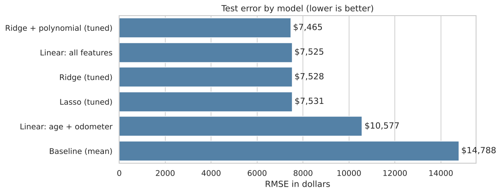
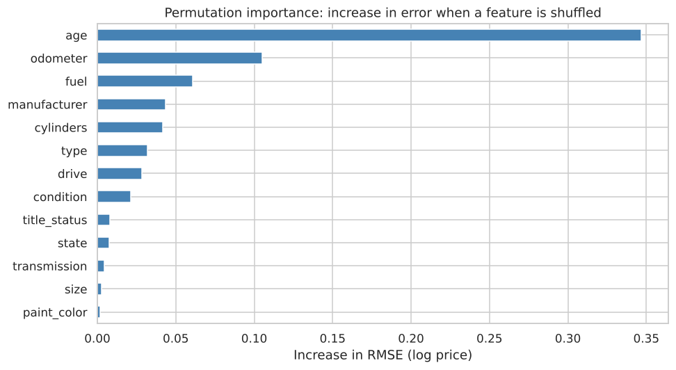
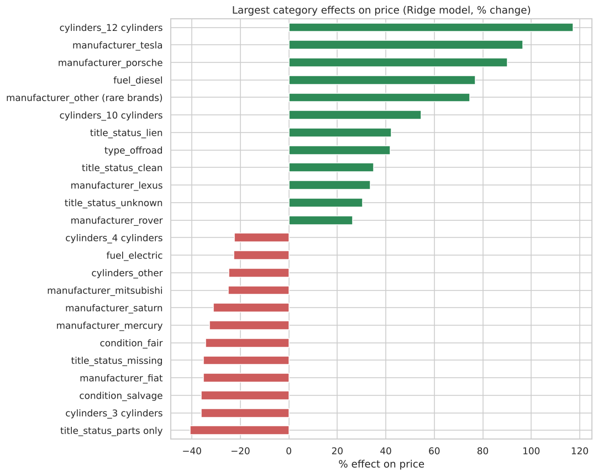

# What Drives the Price of a Used Car?

**Practical Application 2 – UC Berkeley Professional Certificate in Machine Learning & Artificial Intelligence**

📓 **Full analysis notebook:** [`used_car_price_analysis.ipynb`](used_car_price_analysis.ipynb)

## Business problem

A used-car dealership wants to understand **what consumers value in a used car**, so it can fine-tune its inventory and pricing. Using about 426,000 used-car listings, we identified which vehicle characteristics drive price up or down, following the CRISP-DM process.

## Approach

- **Data preparation:**
  - Removed $0 and unrealistic prices (we kept $1,000–$100,000), duplicate listings, very old vehicles (before 1995) and implausible mileage.
  - Converted year into vehicle age.
  - Treated missing categories as "unknown".
  - About 250,000 clean listings remained.
- **Modelling:** six regression models were compared, from a simple baseline to Ridge and Lasso regression and Ridge with polynomial terms. Hyperparameters were tuned with grid search and 5-fold cross-validation. Price was modelled on a log scale, so effects read as percentages.
- **Evaluation metric:** RMSE, reported in dollars. It's easy to explain ("typical error of $X") and it penalises large mispricings, which are the costly ones for a dealer.

## Results

| Model | Typical error (RMSE) | Variation explained (R²) |
|---|---|---|
| Baseline (always guess the average) | $14,788 | 0% |
| Age + mileage only | $10,577 | 52% |
| All features (Linear / Ridge / Lasso) | ~$7,530 | 76% |
| **Best: Ridge + polynomial terms** | **$7,465** | **77%** |

The best model **halves the pricing error** compared with guessing, and performs the same on unseen data as in cross-validation, so it isn't overfitting.

## Key findings: what drives price

1. **Age and mileage matter most.** A car about 6 years older sells for about **35% less**, and about 62,500 extra miles costs about **21%**, everything else being equal.
2. **Diesel vehicles** sell for about **77% more** than comparable gas vehicles.
3. **Brand matters:** Tesla, Porsche, Lexus and Land Rover command large premiums, while Fiat, Mercury, Saturn and Mitsubishi sell at a 25–35% discount.
4. **Bigger engines are worth more:** 10- and 12-cylinder vehicles command premiums, while 3- and 4-cylinder cars sell for 22–36% less.
5. **Pickups, trucks and 4WD vehicles** have the highest prices. Mini-vans and sedans have the lowest.
6. **Damage destroys value:** fair or salvage condition costs about 35%, and parts-only or missing titles cost 35–40%.
7. **Paint colour, size and transmission barely matter.**

## Recommendations for the dealership

- **Stock newer, low-mileage vehicles**, especially **trucks, pickups, 4WD and diesel** models with **clean titles**.
- **Price by brand and engine:** use the premiums and discounts above when valuing trade-ins and setting list prices.
- **Avoid salvage and branded-title cars** unless they can be bought very cheaply.
- **Don't pay extra for cosmetic features** such as paint colour.
- **Use the model as a pricing-guidance tool** to flag cars listed well above or below comparable vehicles.

## Next steps

- Add model and trim information, which was excluded here because of its very high number of values, to sharpen predictions.
- Test tree-based and ensemble models, covered later in the program.
- Capture better data at intake (options, service and accident history) and retrain regularly as market prices change.

## Repository contents

| File | Description |
|---|---|
| `used_car_price_analysis.ipynb` | Full CRISP-DM analysis: data understanding, cleaning, modelling, evaluation and findings |
| `vehicles.csv.zip` | Used-car dataset (426K listings, compressed; read directly by the notebook) |
| `fig_*.png` | Charts used in the notebook and this report |
